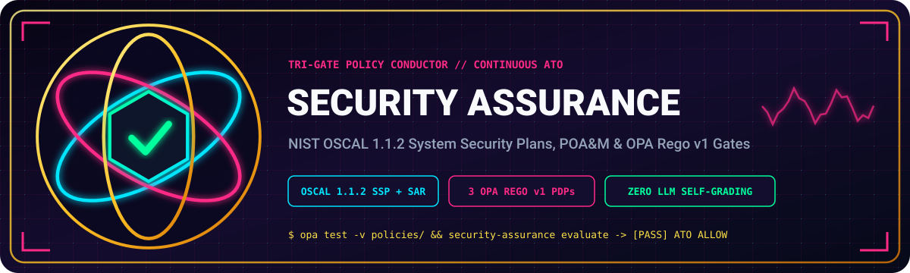
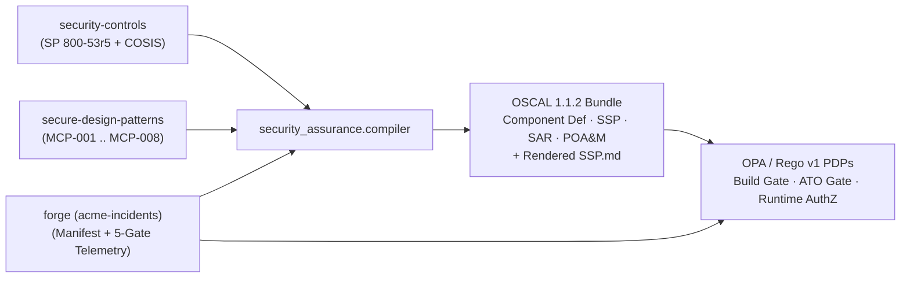

# Security Assurance Hub (`OSCAL 1.1.2` + `OPA/Rego`)

<p align="center">
  
</p>

> **Tying NIST SP 800-53r5 + COSIS [`security-controls`](https://github.com/bsommers/security-controls), MCP [`secure-design-patterns`](https://github.com/bsommers/secure-design-patterns), and [`forge`](https://github.com/bsommers/forge) together into executable OSCAL 1.1.2 System Security Plans (SSPs) and Open Policy Agent (Rego v1) Policy Decision Points.**

[](oscal/ssp-acme-incidents.json)
[](policies/)
[](https://github.com/bsommers/forge)
[](LICENSE)

<p align="center">
  
</p>

---

## How the Ecosystem Fits Together

| Layer | Repository | Responsibility | Primary Artifact |
|-------|------------|----------------|------------------|
| **1. Normative Controls (*What*)** | **[`bsommers/security-controls`](https://github.com/bsommers/security-controls)** | NIST SP 800-53 Rev. 5 (Update 1) catalog + 5 NIST COSIS AI/SI use-case overlays | OSCAL `1.1.2` `profile` JSON |
| **2. Secure Architecture (*How*)** | **[`bsommers/secure-design-patterns`](https://github.com/bsommers/secure-design-patterns)** | Specification-grounded `mcp-serve` patterns (`MCP-001`–`MCP-008`) & reference code | OSCAL `component-definition` ([`component-definition-golden-template.json`](oscal/component-definition-golden-template.json)) |
| **3. Target System (*Evidence*)** | **[`bsommers/forge`](https://github.com/bsommers/forge)** | Hardened FastMCP 4.x (`2026-07-28`) `acme-incidents` server & 5-gate verifier | [`forge-manifest.json`](fixtures/forge-acme-incidents/forge-manifest.json) + [`validate-mcp-evidence.json`](fixtures/forge-acme-incidents/validate-mcp-evidence.json) |
| **4. Continuous ATO (*Assurance*)** | **[`bsommers/security-assurance`](https://github.com/bsommers/security-assurance)** *(this repo)* | Compiles OSCAL SSP/SAR/POA&M + rendered Markdown SSP and enforces **3 OPA/Rego v1 policy gates** | [`ssp-acme-incidents.json`](oscal/ssp-acme-incidents.json), [`acme-incidents-SSP.md`](docs/rendered/acme-incidents-SSP.md), [`policies/**/*.rego`](policies/) |



---

## Concrete Examples: OSCAL 1.1.2 + Rego v1 Applied to Forge

### 1. OSCAL `1.1.2` System Security Plan (`oscal/ssp-acme-incidents.json`)
Rather than hand-writing prose compliance docs that drift immediately, `security_assurance.compiler` compiles Forge's Golden Template (`chassis`), domain tools (`overlay`), and organizational governance (`organization`) into a deterministic UUIDv5 OSCAL SSP ([view full JSON](oscal/ssp-acme-incidents.json) · [view rendered Markdown SSP](docs/rendered/acme-incidents-SSP.md)):

```json
{
  "uuid": "55c3c6dc-...",
  "control-id": "ac-6.10",
  "props": [
    { "name": "nist-id", "value": "AC-6(10)" },
    { "name": "implementation-status", "value": "implemented" },
    { "name": "secure-design-patterns", "value": "MCP-005" }
  ],
  "by-components": [
    {
      "component-uuid": "9e8342ab-...",
      "description": "Destructive operations (delete_incident) declare ToolAnnotations(destructiveHint=True), trigger Stage 5 AppSec signoff, and require break-glass tickets in runtime Rego PDP."
    }
  ]
}
```

### 2. Rego PDP 1 — Build-Time Manifest & Governance Gate ([`policies/forge/manifest_guard.rego`](policies/forge/manifest_guard.rego))
Evaluates `forge-manifest.json` + `forge-release-artifacts.json` in CI before container publishing:
```rego
# NIST AC-6(10) / Pattern MCP-005: Destructive Tools Require Explicit AppSec Signoff
has_destructive_tool if {
    some tool in input.manifest.tools
    tool.annotations.destructiveHint == true
}

deny contains msg if {
    has_destructive_tool
    input.release.governance.appsec_approval.approved != true
    msg := "AC-6(10) violation: destructive tool release requires approved AppSec signoff ticket"
}
```

### 3. Rego PDP 2 — OSCAL ATO, Grounding & POA&M Gate ([`policies/oscal/ssp_gate.rego`](policies/oscal/ssp_gate.rego))
Evaluates the compiled OSCAL `{ssp, sar, poam}` bundle:
- **Blocks LLM self-attestation (`CA-2`):** Denies any assessment where an automated/LLM assessor marks organizational controls (`at-3`, `pe-3`, `pm-9`, `ps-6`) as `satisfied`.
- **Enforces honest risk tracking:** Allows `partially-satisfied` technical controls (such as `sc-5` pre-`M4` array slicing) **if and only if** an active remediation item (`POAM-FORGE-W4.4`) exists in [`oscal/poam-acme-incidents.json`](oscal/poam-acme-incidents.json).

### 4. Rego PDP 3 — Runtime MCP Tool Authorization ([`policies/runtime/mcp_tool_authz.rego`](policies/runtime/mcp_tool_authz.rego))
Evaluates every incoming MCP `tools/call` invocation in `< 1 ms`:
```rego
# Tier 3: Destructive tools (delete_incident) require commander role + valid break-glass ticket
allow if {
    input.tool.annotations.destructiveHint == true
    input.caller.role == "incident-commander"
    startswith(input.caller.elevation_ticket, "INC-BREAKGLASS-")
}
```

---

## Quick Start

```bash
# 1. Rebuild all 4 OSCAL 1.1.2 JSON models + rendered Markdown SSP deterministically
PYTHONPATH=src python3 -m security_assurance.cli build-all

# 2. Evaluate manifest_guard and oscal_ssp_gate policies against Forge acme-incidents
PYTHONPATH=src python3 -m security_assurance.cli evaluate

# 3. Validate zero drift, Rego v1 hygiene & Markdown links
python3 scripts/validate_assurance.py

# 4. Run OPA Rego strict check & unit tests (with opa CLI)
opa check --strict policies/
opa test -v policies/

# 5. Run Python test suite, Ruff & strict Mypy
uv run pytest -v
uv run ruff check src scripts tests
uv run mypy --strict -p security_assurance -p scripts
```

---

## Documentation

- **[Strategic Value & Relevance Assessment](docs/ECOSYSTEM_VALUE_AND_RELEVANCE.md)**
- **[Architecture Deep Dive: OSCAL 1.1.2 & OPA/Rego](docs/ARCHITECTURE_OSCAL_AND_REGO.md)**
- **[ADR-0001: Canonical OSCAL JSON SSPs & Rego PDPs](docs/adr/0001-oscal-json-ssps-and-opa-rego-pdps.md)**
- **[Rendered Forge System Security Plan (`acme-incidents-SSP.md`)](docs/rendered/acme-incidents-SSP.md)**

## License

[MIT](LICENSE)
