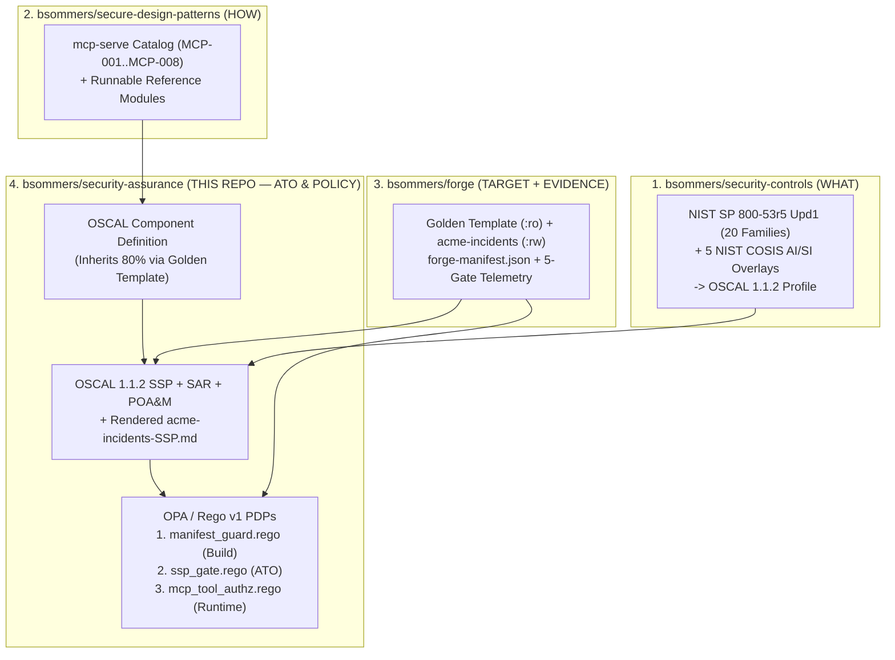

# Architecture Deep Dive: Applying Controls, Patterns, OSCAL 1.1.2 & OPA/Rego to Forge

[← Back to README](../README.md) · [ADR-0001](adr/0001-oscal-json-ssps-and-opa-rego-pdps.md) · [Rendered Forge SSP](rendered/acme-incidents-SSP.md)

---

## 1. How the Four Repositories Fit Together

---

## 2. Should System Security Plans (SSPs) Be in OSCAL?

**Yes — with a dual-output contract:**
1. **Canonical Machine Source of Truth = NIST OSCAL `1.1.2` JSON** ([`oscal/ssp-acme-incidents.json`](../oscal/ssp-acme-incidents.json)):
   - **Component Inheritance (`component-definition`):** Instead of rewriting 20+ control narratives for every forged MCP server, the **FastMCP Golden Template** (`src/{auth,deps,server}.py`) is modeled once in [`oscal/component-definition-golden-template.json`](../oscal/component-definition-golden-template.json). Every forged server automatically inherits `AC-4`, `AC-6`, `AC-6(1)`, `AU-3`, `AU-6`, `CA-2`, `CM-2`, `CM-5`, `IA-9`, `SA-8`, `SC-5`, `SC-7`, `SC-39`, `SI-7(1)`, and `SR-3`. Only overlay-specific controls (`AC-6(10)`, `CM-7`, `PT-2`, `SA-11`, `SI-10`) are computed per OpenAPI spec.
   - **Closed-Loop Evidence & Risk Acceptance (`assessment-results` + `poam`):** Automated 5-gate runs emit [`oscal/assessment-results-acme-incidents.json`](../oscal/assessment-results-acme-incidents.json), while known roadmap gaps (`POAM-FORGE-W4.4` on `SC-5` list-cardinality slicing and `POAM-FORGE-W5.2` on `SC-39` host kernel sandboxing) emit [`oscal/poam-acme-incidents.json`](../oscal/poam-acme-incidents.json).
2. **Human Reviewer View = Deterministically Rendered Markdown** ([`docs/rendered/acme-incidents-SSP.md`](rendered/acme-incidents-SSP.md)):
   - Compiled directly from the OSCAL JSON so Authorizing Officials (AOs) and AppSec reviewers get a clean PR-diffable table with zero manual sync drift.

---

## 3. Where Does Rego (Open Policy Agent) Belong?

**OSCAL is the *noun* (structured security state & evidence); Rego is the *verb* (executable policy decision engine).**

OSCAL cannot evaluate conditional gating logic on its own. Rego operates at **three distinct Policy Decision Points (PDPs)**:

| PDP Stage | Rego Policy | JSON Input | Controls & Patterns Enforced |
|-----------|-------------|------------|------------------------------|
| **PDP 1 — CI / Build Gate** | [`policies/forge/manifest_guard.rego`](../policies/forge/manifest_guard.rego) | `forge-manifest.json` + `forge-release-artifacts.json` | **`CM-7` / `MCP-005`** (`<= 15` tools), **`AC-6` / `MCP-001`** (no token passthrough), **`SC-5` / `MCP-003`** (`<= 32 KiB` cap & `<= 30s` timeout), **`AC-6(10)`** (requires `appsec_approval.approved == true` when `destructiveHint == true`) |
| **PDP 2 — ATO / Compliance Gate** | [`policies/oscal/ssp_gate.rego`](../policies/oscal/ssp_gate.rego) | OSCAL `SSP` + `SAR` + `POA&M` | Verifies 100% of COSIS `P1` controls exist in SSP, **forbids machine/LLM self-attestation** of organizational controls (`AT-3`, `PE-3`, `PM-9`, `PS-6` — **`CA-2`**), and blocks ATO if any technical control is `partially-satisfied` without a matching **POA&M** item |
| **PDP 3 — Runtime Tool Call AuthZ** | [`policies/runtime/mcp_tool_authz.rego`](../policies/runtime/mcp_tool_authz.rego) | `{caller, tool}` per MCP `tools/call` | **`AC-3` & `AC-6(10)`**: `incident-triage-readonly` may invoke `readOnlyHint: true` tools (`get_incident`, `list_incidents`); `incident-responder` may invoke `POST`/`PUT` tools; `delete_incident` (`destructiveHint: true`) requires `role == "incident-commander"` **and** an `INC-BREAKGLASS-*` ticket |
